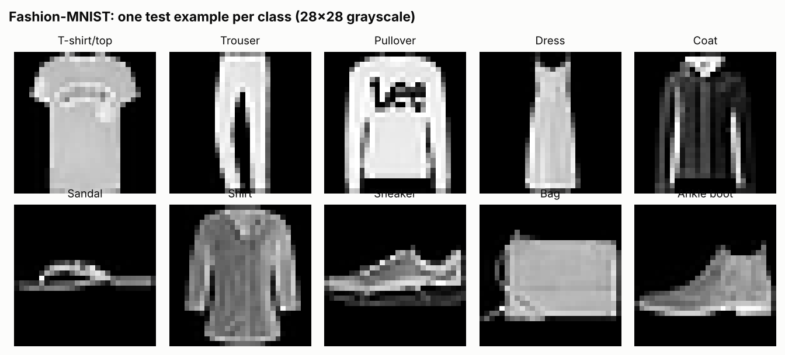
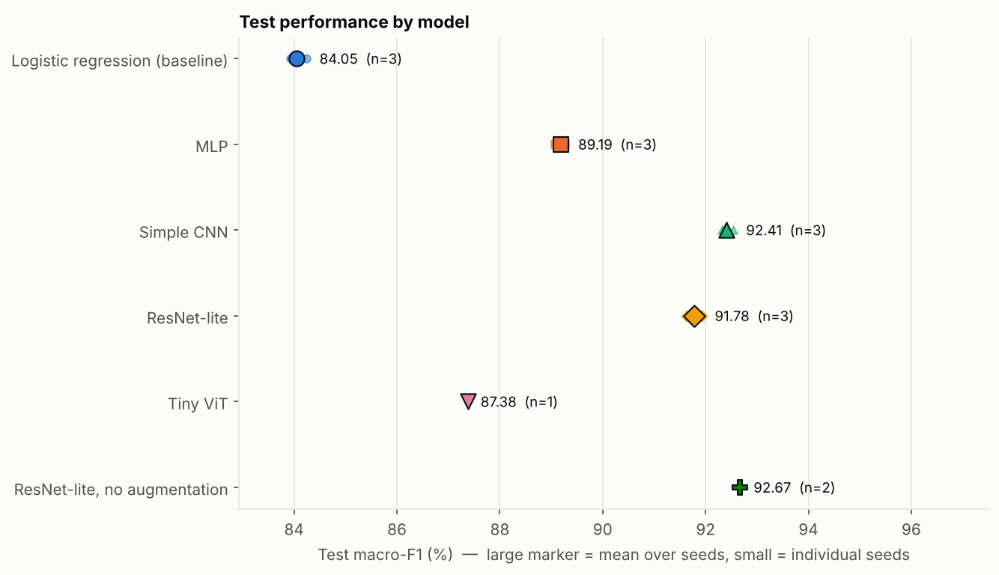
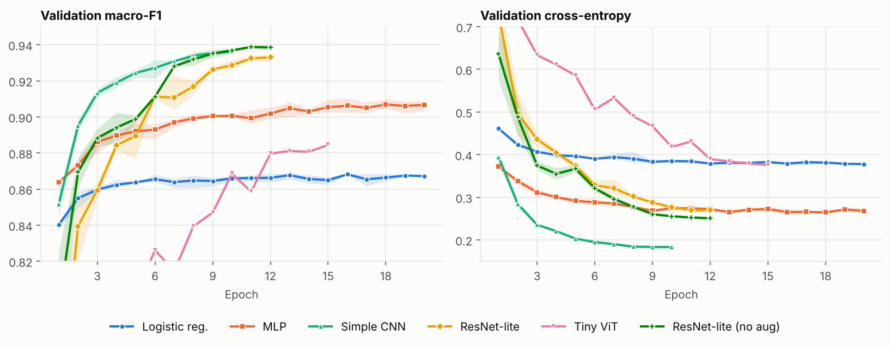
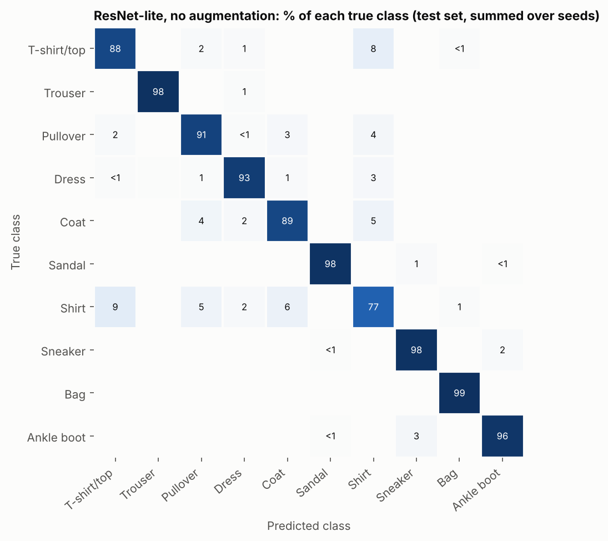
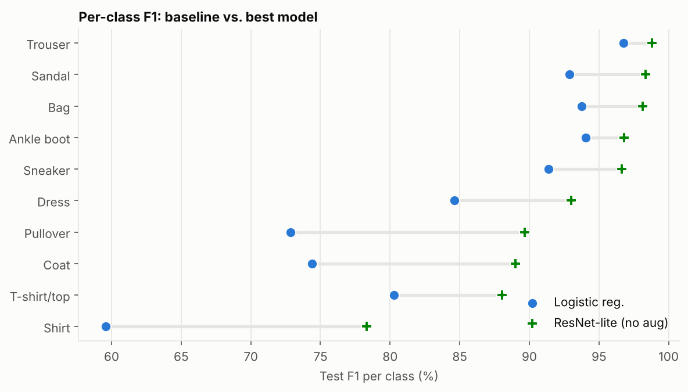
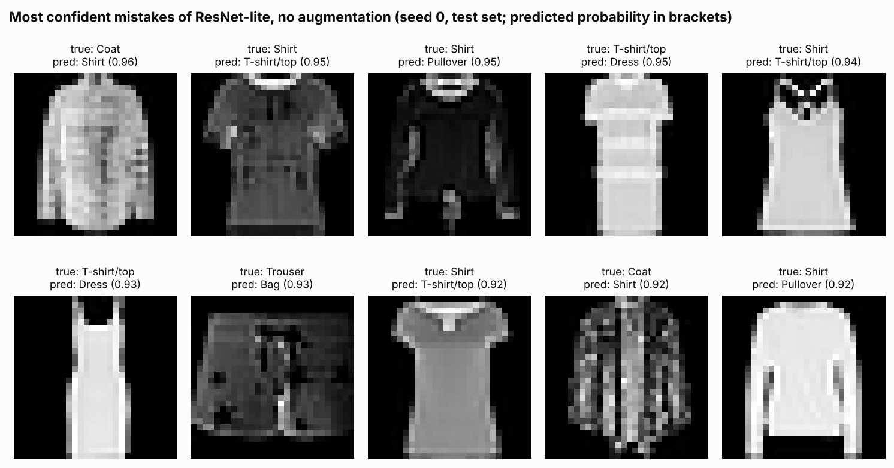

# Fashion-MNIST Image Classification: From Logistic Regression to ResNets and Vision Transformers

A deep-learning mini project in PyTorch. We classify 28×28 grayscale clothing images into 10 categories and compare
six models of increasing sophistication under one common evaluation protocol: a **logistic-regression baseline**, an
**MLP**, a **simple CNN**, a **small ResNet** (with and without data augmentation) and a **small Vision Transformer**.

**Headline results** (test set, macro-F1, mean over seeds):

| Baseline: logistic regression | MLP | Simple CNN | ResNet-lite (no aug) |
|:--:|:--:|:--:|:--:|
| 84.05 % | 89.19 % | 92.41 % | **92.67 %** |

- Going from a linear model to an MLP adds +5.1 points, and convolutions add another +3.2 over an MLP that has *more* parameters.
- ResNet-lite matches the simple CNN statistically (McNemar p = 0.63) with **5.4× fewer parameters** (77.8 k vs 421.6 k).
- Data augmentation + label smoothing *hurt* under our short 12-epoch budget (−0.9 points), and the Tiny ViT
  (87.38 %) fell behind even the MLP. Both look like under-training, not a failure of the idea (see §6).
- The hardest class by far is **Shirt** (F1 78 %), which is confused with T-shirt, Coat and Pullover.

---

## 1. Problem

Multi-class image classification of fashion products (Fashion-MNIST): given a 28×28 grayscale image, predict one of
10 classes (T-shirt/top, Trouser, Pullover, Dress, Coat, Sandal, Shirt, Sneaker, Bag, Ankle boot). The questions we ask:

1. How much does a deep architecture improve over a linear baseline?
2. Do "advanced" architectures (residual networks, Transformers) beat a plain CNN on a small, low-resolution dataset?
3. Where do the models fail, and are the differences between models statistically meaningful?

## 2. Related work

- **Fashion-MNIST** (Xiao, Rasul & Vollgraf, 2017) was introduced as a drop-in, harder replacement for MNIST: 70,000
  images (60k train / 10k test), 10 classes, 28×28 grayscale. The authors benchmarked classical scikit-learn
  classifiers; their best, an RBF-kernel SVM, reached about 89.7 % test accuracy, and a one-hidden-layer ReLU network
  about 87.1 %. Our MLP (89.2 %) is close to that best classical result (slightly below it); our CNNs exceed it.
- **CNNs.** LeNet-style convolution–pooling stacks (LeCun et al., 1998) are the classic approach; our *Simple CNN*
  follows that design. **ResNets** (He et al., 2016) add skip connections and batch normalisation, which make deeper
  networks easier to optimise.
- **Vision Transformers** (Dosovitskiy et al., 2021) split an image into patches and apply self-attention. The ViT
  paper notes that, lacking the locality and translation-equivariance biases of CNNs, they generalise poorly when
  trained on too little data. A recent literature review of CNNs vs. ViTs on Fashion-MNIST (Bouzidi et al., 2024)
  frames the trade-off as CNNs capturing local patterns and ViTs capturing global context, with results depending on
  dataset size, image resolution and hardware.
- **Training recipes** we use: AdamW (Loshchilov & Hutter, 2019), the one-cycle learning-rate schedule
  (Smith & Topin, 2017), label smoothing (Szegedy et al., 2016), dropout and batch normalisation.

Full references are at the bottom.

## 3. Dataset

| | |
|---|---|
| Source | Official Zalando Research repository (downloaded automatically by `src/data.py`); also on [Kaggle](https://www.kaggle.com/datasets/zalando-research/fashionmnist) |
| Size | 70,000 images, 28×28, 8-bit grayscale, 10 classes |
| Our split | **55,000 train / 5,000 validation** (stratified, fixed seed 42, taken from the official training set) / **10,000 test** (official test set, used only for the final report) |
| Balance | Balanced classes (5,500 train, 500 val and 1,000 test images per class), so accuracy and macro-F1 are nearly identical |
| Preprocessing | Scale to [0, 1], then standardise with the training-set mean (0.2862) and std (0.3531) |
| Augmentation | Only where stated: random horizontal flip + random ±2-pixel shift (applied on-the-fly to training batches only) |



## 4. Methodology

**Models** (all in `src/models.py`, PyTorch):

| Model | Params | Description | Training recipe |
|---|---:|---|---|
| Logistic regression | 7,850 | One linear layer on flattened pixels (baseline) | AdamW (wd 0), lr 1e-3, 20 epochs, batch 256 |
| MLP | 535,818 | 784-512-256-10, ReLU, dropout 0.3 | AdamW, lr 1e-3, wd 1e-4, 20 epochs, batch 256 |
| Simple CNN | 421,642 | conv32–pool–conv64–pool–FC128–dropout 0.4–FC10 | AdamW, one-cycle lr 2e-3, wd 5e-4, 10 epochs, batch 128 |
| ResNet-lite | 77,754 | Stem + 3 residual blocks (16/32/64 channels, batch norm), global average pooling, dropout 0.2 | AdamW, one-cycle lr 3e-3, wd 5e-4, 12 epochs, batch 128, label smoothing 0.1, **flip + shift augmentation** |
| ResNet-lite, no aug | 77,754 | Identical network and recipe, **augmentation off** (label smoothing kept) | as above |
| Tiny ViT | 139,018 | 4×4 patches → 49 tokens + [CLS], dim 64, 4 pre-norm encoder layers, 4 heads | AdamW, one-cycle lr 2e-3, wd 0.05, 15 epochs, batch 128, label smoothing 0.1, flip + shift augmentation |

**Protocol.**
- Each model uses one fixed, standard recipe (no per-model hyper-parameter search). Epoch budgets differ because of
  compute (see §6).
- For every run we keep the epoch with the best **validation macro-F1** and evaluate *that* checkpoint once on the test set.
- Models are ranked by mean **validation** macro-F1; the test set is not used for selection.
- Seeds change weight initialisation, batch order and augmentation; the data split is identical for all runs.
- Metrics: accuracy, macro-F1 (primary), per-class precision/recall/F1, confusion matrix, parameter count, wall-clock
  training time, inference latency. Pairwise differences are tested with an exact **McNemar test** on the paired test predictions.

## 5. Results

Test set, mean ± sample std over seeds (std omitted when only one seed). Time is wall-clock per run on **one CPU thread**.

| Model | Params | Epochs | Seeds | Test acc (%) | Test macro-F1 (%) | Train time (min) | Inference (ms/img, CPU) |
|---|---:|---:|---:|---:|---:|---:|---:|
| Logistic regression (baseline) | 7,850 | 20 | 3 | 84.06 ± 0.13 | 84.05 ± 0.17 | 0.1 | 0.001 |
| MLP | 535,818 | 20 | 3 | 89.20 ± 0.05 | 89.19 ± 0.11 | 1.1 | 0.010 |
| Simple CNN | 421,642 | 10 | 3 | 92.42 ± 0.12 | 92.41 ± 0.12 | 7.9 | 0.631 |
| ResNet-lite (with augmentation) | 77,754 | 12 | 3 | 91.79 ± 0.14 | 91.78 ± 0.15 | 21.0 | 0.840 |
| Tiny ViT | 139,018 | 15 | 1 | 87.49 | 87.38 | 42.7 | 0.911 |
| **ResNet-lite, no augmentation** | 77,754 | 12 | 2 | **92.69 ± 0.02** | **92.67 ± 0.01** | 20.4 | 0.853 |

The no-augmentation ResNet-lite has the highest validation macro-F1 (93.91 %) and is therefore the "best model" used
in the confusion matrix and error analysis below. It started life as an ablation of the augmented ResNet-lite.
Validation scores are about 1–3 points higher than test scores for *every* model (e.g. baseline 86.9 vs 84.1,
best 93.9 vs 92.7), so validation and test numbers should not be compared with each other. The ranking of the models is the same on both.





*(Axes are clipped to show the converged region; the ViT and ResNet start lower on the left.)*

### Are the differences real? (exact McNemar test, seed 0, 10,000 test images)

| A vs. B | only A correct | only B correct | p-value | Reading |
|---|---:|---:|---:|---|
| ResNet-lite (no aug) vs. Simple CNN | 260 | 248 | 0.63 | **No detectable difference** in accuracy |
| Logistic regression vs. ResNet-lite (no aug) | 188 | 1038 | 9e-143 | Deep model far better |
| MLP vs. Simple CNN | 195 | 526 | 6e-36 | Convolutions clearly help |
| Simple CNN vs. ResNet-lite (with aug) | 349 | 258 | 2.5e-4 | CNN better |
| ResNet-lite (no aug) vs. (with aug) | 300 | 197 | 4e-6 | Augmentation hurt in this setup |
| ResNet-lite (with aug) vs. Tiny ViT | 634 | 218 | 9e-48 | ResNet-lite far better |

(Single-seed paired test; with 10,000 test images the binomial standard error of an accuracy near 92 % is about 0.3 points.)

### Error analysis



- Footwear, bags and trousers are essentially solved (F1 ≥ 96.6 %). Errors concentrate on **upper-body garments**:
  Shirt 78.3 %, T-shirt/top 88.0 %, Coat 89.0 %, Pullover 89.7 %.
- The most frequent confusions are Shirt → T-shirt/top (9.2 % of shirts), T-shirt/top → Shirt (7.6 %),
  Shirt → Coat (5.9 %) and Shirt → Pullover (4.8 %).
- The largest gain over the baseline is exactly on these hard classes: Shirt goes from 59.6 % to 78.3 % F1 (+18.7 points),
  against +8.6 points on average across classes.





Several of the most confident mistakes show items that are visually ambiguous between the two labels at 28×28
resolution (we did not audit the labels, so this is an impression, not a measured label-noise rate). This suggests a
ceiling for this resolution that is hard to pass without more pixels or context.

Full tables (per-class F1, confusions, McNemar, generalisation gaps) are in [`results/summary.md`](results/summary.md),
and every individual run (history, per-class metrics, confusion matrix) is in `results/runs/`.

## 6. Discussion

**What we learned**

1. *Inductive bias beat raw capacity.* The simple CNN has fewer parameters than the MLP (422 k vs 536 k) yet is +3.2
   F1 points better. Weight sharing and locality are a better fit for images than dense layers.
2. *Residual networks bought parameter-efficiency, not accuracy.* ResNet-lite (no aug) ties the simple CNN with
   5.4× fewer parameters. It was **not** cheaper to run on our CPU: training took ~2.6× longer and inference
   was ~35 % slower per image, because its 28×28 feature maps are processed with batch norm and extra layers.
3. *Regularisation needs a matching schedule.* Adding augmentation to ResNet-lite lowered test F1 by 0.9 points.
   For the augmented model the training accuracy (measured on augmented batches) stays *below* validation accuracy
   and its best epoch is at the end of the schedule (11.7 of 12 on average), which is consistent with
   under-fitting: a small network with only 12 epochs may not have time to benefit from stronger regularisation.
   We did not test this directly (it would need longer schedules).
4. *The ViT was budget-limited.* It scored 87.38 %, below the MLP, but its validation curve was still rising at the
   last epoch (best epoch 15 of 15), so the number is a lower bound under a 15-epoch budget rather than a verdict on
   Transformers. It is also in line with the ViT paper's observation that Transformers need more data or longer
   training than CNNs.
5. *Look at classes, not just the average.* A 1-point change in macro-F1 hides a ~19-point change on Shirt.

**Challenges**

- **Compute.** Everything ran on a 2-core CPU (one thread per job). The ViT alone took ~43 minutes per run, which
  forced short schedules and few seeds.
- **Fair comparison.** Models have different natural training recipes. We gave each a standard recipe rather than
  tuning, so differences partly reflect recipes as well as architectures.
- **Ambiguous classes.** The Shirt / T-shirt / Pullover / Coat group is intrinsically hard at 28×28 grayscale.

**Limitations**

- One dataset, low resolution; results may not transfer to colour or high-resolution product photos.
- Few seeds (3, 3, 3, 3 for the first four models; 2 for ResNet-lite without augmentation; 1 for the ViT) and a single-seed McNemar test.
  The second seed of the no-augmentation ResNet-lite was added after seeing the first one's test result, to firm up the comparison.
- No hyper-parameter search; the "best model" was picked (on validation) from six candidates, one of which
  was introduced as an ablation, so a small selection effect is possible. Treat the ranking of the top two models as a tie.
- Epoch budgets differ between models (20/20/10/12/15/12).

## 7. Future work

- Train ViT and ResNet for much longer (50–200 epochs) and re-test the augmentation question with stronger
  schedules, mixup/CutMix or random erasing.
- Hybrid models (a convolutional stem feeding a Transformer) and distillation from a CNN teacher, which usually helps small-data ViTs.
- Hyper-parameter search (width, depth, learning rate), ensembling several seeds, and test-time augmentation.
- Audit the labels of the confidently-wrong images and add Grad-CAM visualisations for the Shirt / T-shirt confusion.
- Add GPU support to `src/train.py` (currently CPU-only) and try higher-resolution product-image datasets.

## 8. Reproducing the results

```bash
git clone <this-repo> && cd fashion-mnist-classification
python -m venv .venv && source .venv/bin/activate
pip install -r requirements.txt

python -m pytest -q            # fast sanity tests (~15 s)
python -m src.run --quick      # smoke test: every model, 1 epoch, small subset
python -m src.report           # rebuild tables and figures from results/runs
```

The dataset downloads automatically to `data/raw/` on first use. To retrain (about 3 CPU-hours in total, one thread):

```bash
python -m src.run --models logreg mlp cnn resnet --seeds 3
python -m src.run --models vit --seeds 1
python -m src.run --models resnet_noaug --seeds 2
python -m src.report
```

Finished runs are skipped, so an interrupted job can simply be restarted. Use `--models`, `--seeds` and `--threads` to
scale the work. Environment used: Python 3.13, PyTorch 2.14 (CPU), scikit-learn 1.9. Results may differ slightly on other
hardware or library versions. The training logs are in `logs/`; some end with a run that was deliberately
interrupted when the remaining work was redistributed over the two CPU cores. The finished runs are exactly the ones in `results/runs/`.

## 9. Repository layout

```
├── README.md              this report
├── requirements.txt
├── src/
│   ├── data.py            download, parse, split, normalise
│   ├── models.py          LogReg, MLP, SimpleCNN, ResNetLite, TinyViT
│   ├── train.py           training loop, augmentation, evaluation
│   ├── run.py             experiment runner (hyper-parameters live in CONFIGS)
│   └── report.py          aggregation, McNemar tests, figures
├── tests/test_smoke.py    sanity tests
├── results/
│   ├── summary.md|json    final tables
│   ├── runs/              per-run metrics + test predictions
│   ├── checkpoints/       best weights (seed 0) of every model
│   └── figures/           all plots used above
└── logs/                  raw training logs
```

## References

1. H. Xiao, K. Rasul, R. Vollgraf. *Fashion-MNIST: a Novel Image Dataset for Benchmarking Machine Learning Algorithms.* arXiv:1708.07747, 2017.
2. S. Bouzidi, G. Hcini, I. Jdey, F. Drira. *Convolutional Neural Networks and Vision Transformers for Fashion MNIST Classification: A Literature Review.* arXiv:2406.03478.
3. Y. LeCun, L. Bottou, Y. Bengio, P. Haffner. *Gradient-based learning applied to document recognition.* Proceedings of the IEEE, 86(11), 1998.
4. K. He, X. Zhang, S. Ren, J. Sun. *Deep Residual Learning for Image Recognition.* CVPR 2016. arXiv:1512.03385.
5. A. Dosovitskiy et al. *An Image is Worth 16x16 Words: Transformers for Image Recognition at Scale.* ICLR 2021. arXiv:2010.11929.
6. I. Loshchilov, F. Hutter. *Decoupled Weight Decay Regularization.* ICLR 2019. arXiv:1711.05101.
7. L. N. Smith, N. Topin. *Super-Convergence: Very Fast Training of Neural Networks Using Large Learning Rates.* arXiv:1708.07120, 2017.
8. C. Szegedy et al. *Rethinking the Inception Architecture for Computer Vision.* CVPR 2016. arXiv:1512.00567.
9. S. Ioffe, C. Szegedy. *Batch Normalization: Accelerating Deep Network Training by Reducing Internal Covariate Shift.* ICML 2015. arXiv:1502.03167.
10. N. Srivastava et al. *Dropout: A Simple Way to Prevent Neural Networks from Overfitting.* JMLR 15, 2014.
